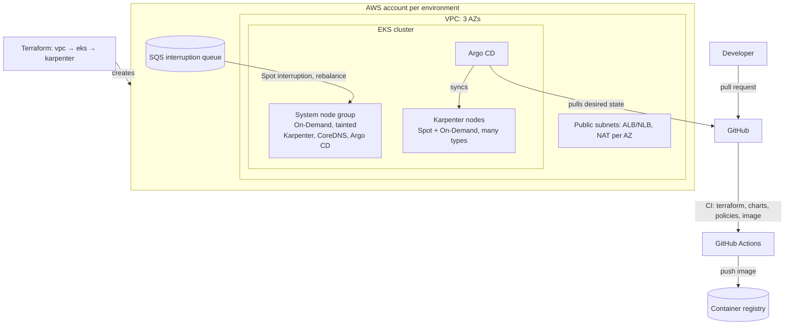

# eks-platform-blueprint

A reference implementation of an Amazon EKS platform: Terraform for the infrastructure, a Helm
library chart that every service deploys with, and Argo CD ApplicationSets that roll the same
services out to every environment from Git. It runs end to end on a local
[kind](https://kind.sigs.k8s.io/) cluster with no AWS account, and the same Terraform applies to
AWS.

It's a personal project that rebuilds, in the open, the patterns I used running Kubernetes
platforms for telecom customers: standard deployments, multi-environment Terraform, GitOps,
zero-downtime rollouts and phased migrations. None of it is code from a former employer.

## What's in it

| Area | What it shows | Where |
|---|---|---|
| **Terraform** | Own modules for the VPC, EKS and Karpenter, composed into one `platform` module; `dev` and `prod` differ only in `.tfvars`; S3 state with native locking; input validation that rejects unsafe values (e.g. an API endpoint open to `0.0.0.0/0`) | [`terraform/`](terraform/) |
| **EKS design** | Access entries instead of `aws-auth`, KMS envelope encryption of secrets, EKS Pod Identity for workload AWS access, IMDSv2 with hop limit 1, VPC CNI prefix delegation and NetworkPolicy enforcement, a tainted On-Demand system node group running Karpenter, Spot-first NodePools with consolidation and a hard CPU/memory cap | [`terraform/modules/eks`](terraform/modules/eks), [`gitops/platform/karpenter-config`](gitops/platform/karpenter-config) |
| **Helm framework** | A library chart with the standard objects (Deployment, Service, PDB, HPA, NetworkPolicy, ServiceMonitor, Ingress); a service is just a values file. Guard rails fail the render on a missing or `latest` image tag or missing resources | [`charts/`](charts/) |
| **GitOps** | App of apps; ApplicationSets that combine every registered cluster with every service directory (matrix generator); add-ons per cluster type; AppProjects that keep app teams to namespaced objects | [`gitops/argocd`](gitops/argocd) |
| **Zero-downtime rollouts** | `maxUnavailable: 0`, readiness gating, a `preStop` sleep, a service that stops reporting ready on SIGTERM and drains, PDBs, zone spreading. Measured with a test that sends traffic during a full rollout | [`scripts/rollout-test.sh`](scripts/rollout-test.sh) |
| **Policy** | Kyverno policies enforcing the same rules at admission (immutable tags, requests and limits, readiness probes, non-root, at least 2 replicas in prod), also run in CI against every rendered manifest | [`gitops/platform/kyverno-policies`](gitops/platform/kyverno-policies) |
| **CI** | Terraform fmt/validate/tflint/Checkov per environment; Helm lint, render of every service × environment, kubeconform schema checks, Kyverno CLI; app tests, image build and Trivy scan | [`.github/workflows/ci.yml`](.github/workflows/ci.yml) |
| **Runbooks** | A wave-based OpenStack → EKS migration with weighted cutovers and rollback triggers; one-minor-version EKS upgrades | [`docs/runbooks/`](docs/runbooks/) |

Design choices and their trade-offs: [`docs/decisions.md`](docs/decisions.md).

## Architecture



Request path in the cluster: Route 53 → load balancer (AWS Load Balancer Controller, IP targets)
→ Service → Ready pods only; NetworkPolicies allow only the ingress, monitoring and declared
calling services.

## Run it locally (no AWS account)

Needs Docker, kind, kubectl and Helm (on Windows: inside WSL2).

```bash
scripts/local-up.sh                # kind cluster across two "zones", both services via Helm
scripts/rollout-test.sh orders     # traffic during a full rollout; prints non-200 responses
scripts/local-up.sh --gitops       # instead: Argo CD deploys everything from this repo
scripts/local-down.sh
```

## Deploy to AWS

```bash
cd terraform/envs/dev
# set the state bucket in backend.tf and your CIDRs/SSO roles in terraform.tfvars
terraform init && terraform plan -out tfplan && terraform apply tfplan
aws eks update-kubeconfig --name blueprint-dev
KUBE_CONTEXT=$(kubectl config current-context) scripts/bootstrap-argocd.sh dev aws \
  "$(terraform output -raw karpenter_interruption_queue)" "$(terraform output -raw karpenter_node_role_name)"
```

A `dev` environment costs roughly the EKS control plane, two system nodes and one NAT gateway
while it runs; `terraform destroy` removes everything.

## Status: what has been verified

| Part | Status |
|---|---|
| Terraform (`dev`, `prod`) | `fmt`, `validate`, Checkov clean (84 checks, 6 documented skips). **Not yet applied to a real AWS account** |
| Helm charts | Lint clean; every service × environment renders; guard rails tested |
| Local deployment on kind | Both services deploy, one replica per zone, pass startup/readiness/liveness probes |
| Zero-downtime rollout | **0 failed requests** across full rollouts (results below) |
| Kyverno policies | Every service × environment passes; a `:latest`/no-resources/root pod and a 1-replica prod Deployment are rejected (`scripts/policy-test.sh`) |
| Argo CD path | Manifests written; runs once the repository is public |

## Rollout test results

`scripts/rollout-test.sh` sends a request every 50 ms from inside the cluster while every pod of a
service is replaced, then counts responses that weren't HTTP 200 (measured 2026-10-12 on a
3-node kind cluster, Kubernetes 1.34):

| Run | Requests | Not 200 |
|---|---|---|
| `orders`, platform defaults | 509 | 0 |
| `payments`, longer drain (preStop 15 s, grace 60 s) | 529 | 0 |
| `orders` with preStop cut to 1 s and the app's drain turned off | 490 | 0 |

The third run is a control: on a small local cluster, endpoint removal reaches kube-proxy almost
instantly, so even reduced protections didn't drop requests here. The preStop sleep and the
app's drain exist for environments where that propagation is slow: AWS load balancer target
deregistration, many nodes, external proxies. That's the case to test again on EKS.

## What I'd add for production
External Secrets Operator with AWS Secrets Manager; the AWS Load Balancer Controller and
ExternalDNS; Argo Rollouts canaries with Prometheus analysis; remote write to Amazon Managed
Prometheus; Velero backups; per-team ResourceQuotas; image signing with cosign verified by
Kyverno; Terraform plans posted to pull requests (Atlantis or HCP Terraform).
