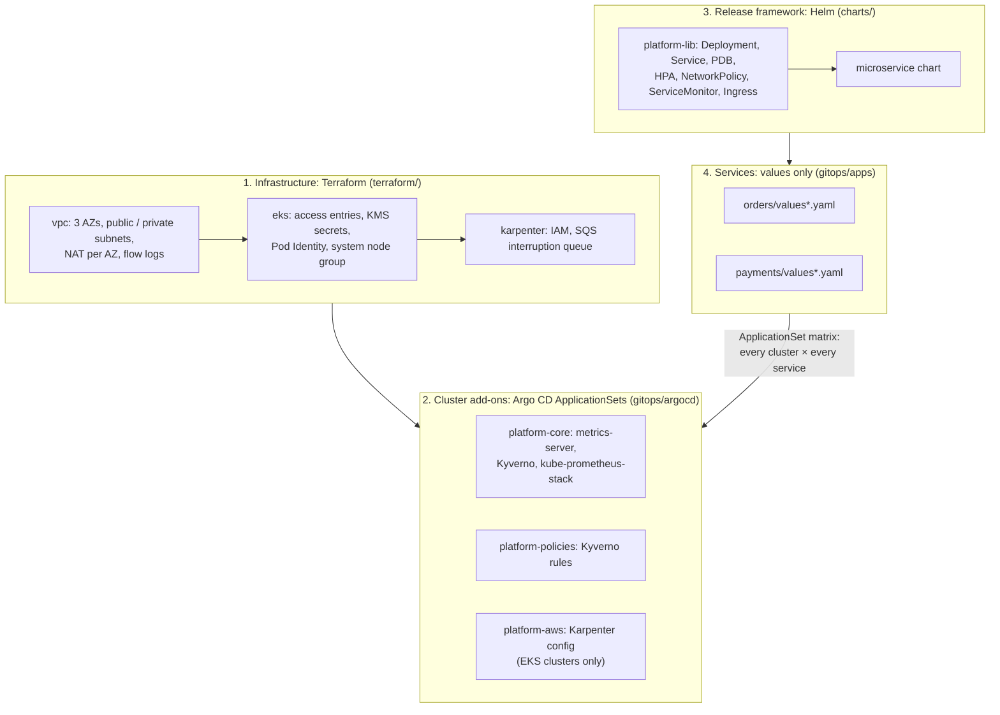

# eks-platform-blueprint: architecture

The reasoning behind each choice is in [`decisions.md`](decisions.md), and the procedures are in [`runbooks/`](runbooks/). This page ties the layers together.

## 1. Context

A platform team gives application teams a way to run services on Kubernetes without each team learning Terraform, EKS internals, Helm and Argo CD. The contract:
- a team adds a directory with a values file;
- the platform supplies the cluster, the release mechanics, the guard rails and the observability.

The blueprint is that platform, in four layers, each owned and changed in one place.

## 2. How a change flows

| Change | Where | Reaches clusters by |
|---|---|---|
| Cluster, network, node capacity | `terraform/envs/<env>/terraform.tfvars` | `terraform plan` / `apply` per environment, after CI (fmt, validate, tflint, Checkov) |
| An add-on version | `gitops/argocd/platform.yaml` | Argo CD sync, add-on by add-on (sync waves) |
| A policy | `gitops/platform/kyverno-policies` | Argo CD sync; the same policies run in CI against every rendered manifest |
| A new service | a new directory under `gitops/apps` | The ApplicationSet matrix generator creates one Application per registered cluster |
| A service's version | the `image.tag` in its values | Argo CD sync, rolling update with `maxUnavailable: 0` |
| A new cluster | register it in Argo CD with labels (`env`, `provider`) | It gets every add-on and every service for its environment |

Git is the only write path. Argo CD's self-heal reverts manual changes, and the GitOps e2e test measures how fast.

## 3. Key design points

- **Identity and access:** EKS access entries instead of the `aws-auth` ConfigMap; EKS Pod Identity for workloads instead of IRSA annotations; IMDSv2 with a hop limit of 1, so pods can't reach the node's credentials.
- **Capacity:** a small, tainted On-Demand node group runs Karpenter and the cluster-critical pods. Everything else runs on Karpenter NodePools: Spot first across many instance types, consolidation on, with a hard CPU and memory cap so a runaway deployment can't buy unlimited nodes. Spot interruptions arrive through SQS, and nodes drain before they're reclaimed.
- **Releases without errors:**
  - `maxUnavailable: 0`;
  - readiness gates traffic;
  - a `preStop` sleep covers endpoint propagation;
  - the app stops reporting ready on SIGTERM and drains in-flight requests;
  - PDBs, and spreading across zones.
- **Requests and limits:** CPU requests without CPU limits, to avoid CFS throttling; a memory limit as a safety net.
- **Guard rails, enforced twice:**
  - the Helm library refuses to render without an immutable image tag and resources;
  - Kyverno rejects at admission: `:latest`, missing requests or probes, root or privilege escalation, and fewer than 2 replicas in prod;
  - the same policies run in CI, so a violation fails the pull request.

## 4. Verification

| What | How | Result |
|---|---|---|
| Terraform | fmt, validate, tflint, Checkov per environment | Clean (84 checks, 6 documented skips); not applied to a real AWS account |
| Charts | Lint, render every service × environment, kubeconform, Kyverno CLI | Clean; guard rails tested |
| Zero-downtime rollout | `scripts/rollout-test.sh`: traffic every 50 ms during a full rollout on kind | 0 failed requests in 3 runs |
| Policies | `scripts/policy-test.sh` | Bad pods and a 1-replica prod Deployment rejected |
| **GitOps path** | `scripts/gitops-e2e.sh` in CI on `main`: Argo CD gets only the root app; add-ons, policies and services must arrive from GitHub; then the services must answer, a deleted Service and a hand-edited Deployment must be put back by self-heal (timed), and a bad pod must be rejected by the Kyverno policies Argo CD installed | See the README |

## 5. Failure modes

| Failure | Handling |
|---|---|
| An AZ is lost | Nodes and pods are spread across 3 AZs; NAT per AZ, so the other AZs keep egress; PDBs keep drains orderly |
| Spot capacity is reclaimed | The SQS interruption queue lets Karpenter cordon and drain within the 2-minute notice; multiple instance types and On-Demand fallback |
| A bad release | Readiness never passes, so the rollout stalls with the old pods still serving (`maxUnavailable: 0`); revert the values commit |
| Someone changes the cluster by hand | Self-heal reverts it; the change belongs in Git |
| A runaway workload | NodePool limits cap total capacity; ResourceQuotas per team are the next step |

## 6. Next steps

- Apply to a sandbox AWS account from CI (OIDC) and repeat the rollout test behind a real load balancer, where endpoint propagation is slower.
- External Secrets with AWS Secrets Manager; AWS Load Balancer Controller and ExternalDNS; Argo Rollouts canaries with Prometheus analysis.
- Velero backups, per-team ResourceQuotas, and Terraform plans posted to pull requests.
